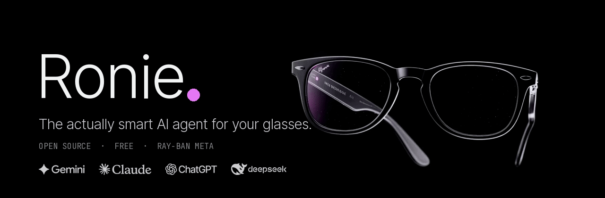

<p align="center"></p>

# Smart Glasses AI Agent

**Make your Ray-Ban Metas do what Meta AI can't.**

An open-source, hands-free AI agent for Ray-Ban Meta smart glasses. Say "Ronie" and just talk. It sees what you see, plays things on your TV, opens them on your laptop, and answers live. It runs on free AI APIs, so there's no subscription.

> Not affiliated with, endorsed by, or sponsored by Meta Platforms or Ray-Ban (EssilorLuxottica). "Ray-Ban Meta" is used only to say which glasses this works with.

**▶ The launch film (1:38, turn the sound on):**

https://github.com/user-attachments/assets/90b6202b-6237-4d71-889a-12c43a5b61bb

## What it does

| Say | What happens |
|---|---|
| "Ronie, play Stranger Things on the TV" | Opens the show on your Android / Google TV and starts it |
| "Play some lofi on my laptop" | Plays it on YouTube in your browser on the laptop |
| "Explain how black holes form" (at home) | Answers in your ear, and puts a video plus an article on the screen you're facing |
| "What am I looking at?" | Takes a photo with the glasses and tells you |
| "Turn on the PlayStation" | Wakes the PS5 and switches the TV to it |
| "Set the TV volume to 15" | Sets that exact volume |
| "What's the weather today?" / "Latest F1 result?" | Searches the web and gives you the short answer |
| "Remember, my locker number is 42" | Remembers it for later, across every session |
| "What's my best move?" (chess board in view) | Reads the board and suggests the move |
| "Switch to interview mode" | Gives quiet answer points in your ear during a real interview |
| Speak your own language | Understands several languages and accents: Hindi and English today, with more on the way |
| "Stop" | Stops talking at once and listens |

### Compared with the built-in assistant

| | This project | Built-in Meta AI |
|---|---|---|
| Control your Android TV, apps and HDMI devices (PS5) | Yes | No |
| Open videos and pages on your laptop, across both displays | Yes | No |
| Shows things on the screen you're facing, at home | Yes | No |
| Chess-engine moves and poker odds from what you see | Yes | No |
| Quiet answer points during a real interview, and mock interviews | Yes | No |
| Open source, runs on your own server, free APIs | Yes | No |

## How it works

```
 Glasses (mic, speakers, camera)
        │ Bluetooth
 Android app ── Gemini Live (real-time voice) ──┐
        │                                        │ tools: web, memory, TV, laptop, games
        └──────── WebSocket ───────── Brain server (FastAPI, on your laptop or a free cloud VM)
                                          │                 │
                                   Laptop agent        TV (via the phone's
                                   (Windows)           Android TV remote link)
```

- **Android app** (Kotlin, Jetpack Compose): wake word, the voice session with Gemini Live, the glasses camera (Meta Wearables SDK), and the TV remote.
- **Brain server** (Python, FastAPI): instructions, tools, shared memory, the free model router (Gemini, Groq, OpenRouter, optional Ollama), web research and pairing.
- **Laptop agent** (Windows): opens sites and apps, controls media and volume, lays out windows across displays, and hears call audio for interview mode.

## Get started

You need Ray-Ban Meta glasses, an Android 14+ phone, and a free Gemini API key. A Windows laptop and an Android / Google TV are optional.

The full step-by-step guide is in **[docs/SETUP.md](docs/SETUP.md)**. In short:

1. Get free API keys: Gemini (required), Groq and OpenRouter (recommended).
2. Run the brain server on your laptop, or on a free cloud server so it works away from home.
3. Build and install the Android app, then pair it with the brain.
4. Optional: pair your TV in the app, and run the laptop agent.

## Cost

Everything runs on free tiers: Gemini, Groq and OpenRouter free models, plus Oracle Cloud's Always Free server if you want it online. Paid models (Claude, OpenAI, DeepSeek) are optional and only used if you add a key and turn on Premium.

## Privacy

- Your memory, keys and settings stay on your own brain server, never in this repo.
- API keys are stored on the server and never sent back to the app.
- The "which screen are you facing" photo is taken only at home, from the glasses, is used once and isn't stored.

## Project layout

| Folder | What's in it |
|---|---|
| `android-app/` | The phone app |
| `brain/` | The brain server, laptop agent and tests |
| `pc-companion/` | Optional desktop voice client |
| `shared/` | The message protocol between the parts |
| `docs/` | Setup guide and product plan |

## Contributing

Issues and pull requests are welcome. Run the brain tests with `pytest` in `brain/`.

Fonts: Inter Tight and JetBrains Mono, under the SIL Open Font License (see `android-app/fonts-license/`).

## License

MIT, see [LICENSE](LICENSE).
